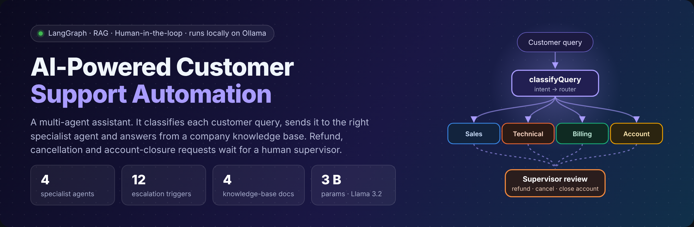
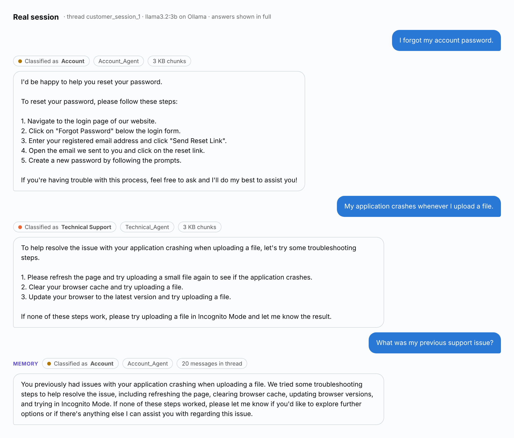
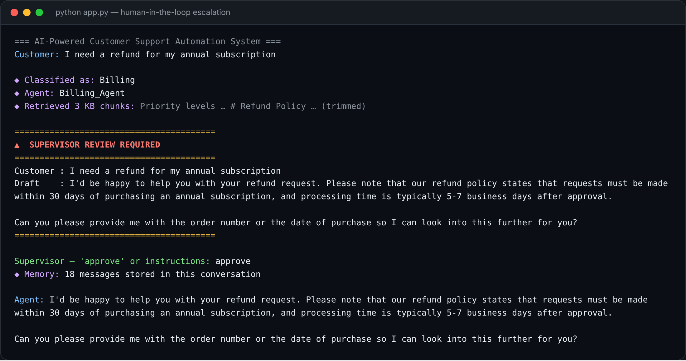
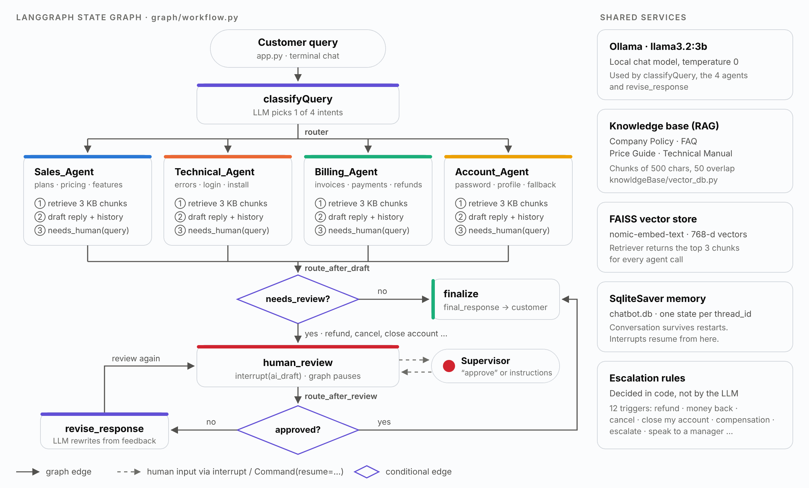
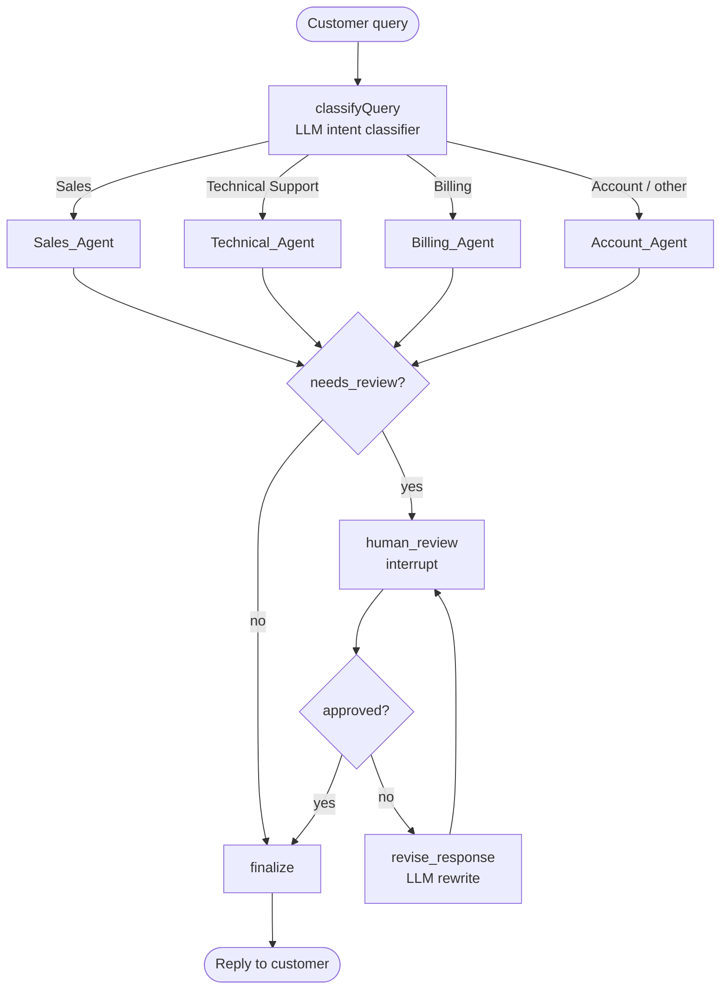
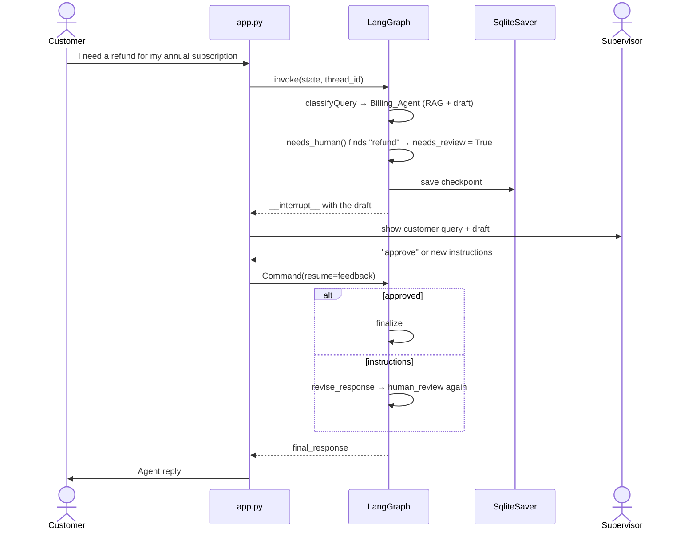
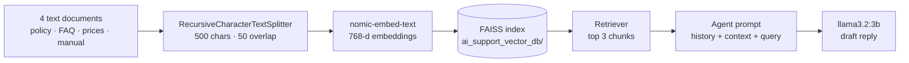

<div align="center">



<br>

[](https://www.python.org/)
[](https://langchain-ai.github.io/langgraph/)
[](https://python.langchain.com/)
[](https://ollama.com/)
[](https://github.com/facebookresearch/faiss)
[](https://langchain-ai.github.io/langgraph/concepts/persistence/)
[](#-human-in-the-loop)

**[See it work](#-see-it-work)** · **[Architecture](#-architecture)** · **[Human-in-the-loop](#-human-in-the-loop)** · **[RAG](#-knowledge-base-rag)** · **[Run it](#-run-it-yourself)**

</div>

---

A customer-support assistant built as a **LangGraph state graph**.
An LLM reads each query and picks one of four intents. A router sends the query to the matching **specialist agent**.
The agent answers from a **FAISS knowledge base** of company documents.
Risky requests, such as refunds, cancellations and account closures, **pause the graph for a human supervisor**.
A **SQLite checkpointer** keeps every conversation, so the assistant remembers earlier turns, even after a restart.

Everything runs on your own machine through **Ollama**. No cloud API keys are needed.

## ⚡ At a glance

| | |
|---|---|
| **Agents** | 4 specialists: Sales · Technical Support · Billing · Account |
| **Routing** | LLM intent classifier (`classifyQuery`) → `router` → agent node |
| **Answers** | RAG over 4 company documents · FAISS · top-3 chunks · conversation history in every prompt |
| **Safety** | Escalation decided **in code**, not by the LLM · 12 trigger phrases · supervisor approves or rewrites |
| **Memory** | `SqliteSaver` checkpoints per `thread_id` in `chatbot.db` · survives restarts |
| **Models** | `llama3.2:3b` (chat, temperature 0) · `nomic-embed-text` (768-d embeddings) · both on Ollama |
| **Interface** | Terminal chat (`app.py`) with an inline supervisor prompt |

---

## 🎬 See it work

These are real turns from one session, read back from `chatbot.db`. Each turn shows the routing decision the app printed.

<picture>
  <source media="(prefers-color-scheme: dark)" srcset="assets/diagrams/demo-conversation-dark.png">
  
</picture>

### A refund request goes to a supervisor first



<sub>Text is copied from the run. Emoji in the terminal output are shown as ◆ / ▲. The retrieved chunks are trimmed. The original screenshots are in [`docs/screenshots/`](docs/screenshots/).</sub>

### Routing log from that session

| # | Customer query | Classified as | Agent | Supervisor review |
|---:|---|---|---|---|
| 1 | What are the pricing plans available for your software? | Sales | `Sales_Agent` | — |
| 2 | I forgot my account password. | Account | `Account_Agent` | — |
| 3 | My application crashes whenever I upload a file. | Technical Support | `Technical_Agent` | — |
| 4 | I need a refund for my annual subscription | Billing | `Billing_Agent` | **Yes** · approved |
| 5 | What was my previous support issue? | Account | `Account_Agent` | — |

The thread held 20 messages after this session (10 customer turns over two sessions).

---

## 🧠 Architecture

<picture>
  <source media="(prefers-color-scheme: dark)" srcset="assets/diagrams/architecture-dark.png">
  
</picture>

### The graph, node by node

This is the graph that [`graph/workflow.py`](graph/workflow.py) builds:



1. **`classifyQuery`** asks the LLM for exactly one label: Sales, Technical Support, Billing or Account.
2. **`router`** maps the label to an agent node. Any other label goes to `Account_Agent`. That agent also answers memory questions.
3. The **agent** retrieves 3 knowledge-base chunks and drafts a reply with the recent conversation. It stores the draft in `ai_draft` and sets `needs_review` with `needs_human()`.
4. **`route_after_draft`** sends the turn to `human_review` when `needs_review` is true. Otherwise it goes to `finalize`.
5. **`human_review`** calls `interrupt(ai_draft)`. The graph pauses and `app.py` shows the draft to the supervisor.
6. **`route_after_review`** finalizes on approval. Any other reply goes to **`revise_response`**, which rewrites the draft and loops back to review.
7. **`finalize`** copies the approved draft into `final_response`.

### Who handles what

The classifier prompt in [`nodes/classifyQuery.py`](nodes/classifyQuery.py) defines the four intents:

| Intent | Agent | Typical questions |
|---|---|---|
| 🛒 **Sales** | `Sales_Agent` | Product information · subscription plans · pricing · purchases · feature comparisons |
| 🛠️ **Technical Support** | `Technical_Agent` | App errors · installation · login problems · configuration · bugs · performance |
| 💳 **Billing** | `Billing_Agent` | Invoices · payment issues · refunds · charges · billing history · failed payments |
| 👤 **Account** | `Account_Agent` | Password reset · profile updates · activation / deactivation · settings · email changes |

---

## 🧑‍⚖️ Human-in-the-loop

The graph does not let the LLM decide when a human must step in. Small models do not follow a "return the word human" instruction reliably. So [`utils/escalation.py`](utils/escalation.py) checks the query in plain Python:

```python
ESCALATION_TRIGGERS = [
    "refund", "money back", "cancel", "cancellation",
    "close my account", "close account", "account closure", "delete my account",
    "compensation", "escalate", "speak to a manager", "speak to manager",
]

def needs_human(text: str) -> bool:
    t = text.lower()
    return any(trigger in t for trigger in ESCALATION_TRIGGERS)
```

These triggers match the escalation policy in the knowledge base (`Company_Policy_Document.txt`): refunds, cancellations, account closures, compensation and requests for management always go to a human.

### Pause and resume



The supervisor types **`approve`** (or `yes`, `ok`, `looks good`) to send the draft. Anything else counts as revision instructions.

---

## 📚 Knowledge base (RAG)



| Document | What it covers |
|---|---|
| [`Company_Policy_Document.txt`](knowldgeBase/Company_Policy_Document.txt) | Support hours and priority levels · refund, cancellation, account-closure and compensation rules · escalation policy |
| [`FAQ_document.txt`](knowldgeBase/FAQ_document.txt) | Ten common questions: subscriptions, password reset, free trial, payment methods, browsers, bug reports |
| [`Price_Guide.txt`](knowldgeBase/Price_Guide.txt) | Starter, Professional and Enterprise plans · billing cycles · upgrade and downgrade rules |
| [`Technical_Manual.txt`](knowldgeBase/Technical_Manual.txt) | Platforms · login and password steps · upload limits · crash troubleshooting · API limits |

The company, **ABC Technologies**, is fictional. The documents exist to test the assistant.

Every agent prompt tells the model to use the conversation history for follow-ups, and **only the retrieved context for facts**.

---

## 🗂️ Shared state

All nodes read and write one `TypedDict`, defined in [`graph/CustomerSupportState.py`](graph/CustomerSupportState.py):

| Field | Type | Purpose |
|---|---|---|
| `messages` | list (`add_messages`) | Full conversation. New messages are appended. |
| `customer_queries` | str | Raw customer query |
| `classify_customer_issue` | str | Label from the classifier |
| `support_department` | str | Department that must act |
| `ai_draft` | str | Current draft reply. Review always works on this field. |
| `human_feedback` | str | Supervisor reply during review |
| `kb_context` | str | Retrieved knowledge-base text |
| `needs_review` | bool | True when the request must go to a human |
| `final_response` | str | Answer sent to the customer |

---

## 🚀 Run it yourself

**Needs:** Python 3.11+ and [Ollama](https://ollama.com/) running on your machine.

```bash
# 1. Get the code
git clone https://github.com/R-PAl-AIhub/AI-Powered-Customer-Support-Automation-System.git
cd AI-Powered-Customer-Support-Automation-System

# 2. Install
pip install -r requirements.txt

# 3. Pull the two local models
ollama pull llama3.2:3b          # chat model
ollama pull nomic-embed-text     # embedding model

# 4. Build the vector store (once, or after you change the documents)
python -m knowldgeBase.vector_db

# 5. Chat
python app.py
```

Type `exit` to quit. Run all commands from the project root so the package imports resolve.

**Memory:** `app.py` uses one fixed `thread_id` (`customer_session_1`). The conversation continues after a restart. To start fresh, change the `thread_id` or delete `chatbot.db`.

<details>
<summary><b>Customize</b></summary>

<br>

| To change | Edit |
|---|---|
| Chat model | `utils/llm.py` |
| Embedding model | `knowldgeBase/vector_db.py` **and** `knowldgeBase/database_retriver.py` (both must match) |
| Escalation triggers | `utils/escalation.py` |
| Approval words | `nodes/route_after_review.py` |
| Knowledge base | Add or replace `.txt` files in `knowldgeBase/`, then rebuild the vector store |
| Number of retrieved chunks | `search_kwargs={"k": 3}` in `knowldgeBase/database_retriver.py` |

</details>

---

## 📁 Project structure

```text
.
├── app.py                        # terminal chat loop + supervisor prompt
├── requirements.txt
├── graph/
│   ├── CustomerSupportState.py   # shared TypedDict state
│   └── workflow.py               # builds and compiles the LangGraph graph
├── nodes/
│   ├── classifyQuery.py          # LLM intent classifier
│   ├── router.py                 # label → agent node
│   ├── route_after_draft.py      # human_review or finalize
│   ├── human_review_node.py      # interrupt() for the supervisor
│   ├── route_after_review.py     # finalize or revise_response
│   ├── revise_response.py        # rewrite the draft from feedback
│   └── finalize.py               # final_response
├── agents/
│   ├── sales_agent.py            # each agent: retrieve → draft → needs_human()
│   ├── technical_support.py
│   ├── billing_agent.py
│   └── account_agent.py
├── knowldgeBase/
│   ├── *.txt                     # company documents
│   ├── vector_db.py              # builds the FAISS index
│   ├── database_retriver.py      # loads the index as a retriever
│   └── ai_support_vector_db/     # saved FAISS index
├── utils/
│   ├── llm.py                    # ChatOllama config
│   ├── escalation.py             # needs_human()
│   └── history.py                # format_history() for follow-ups
├── assets/diagrams/              # images in this README
├── scripts/diagrams/             # HTML sources for those images
├── docs/screenshots/             # original terminal screenshots
└── chatbot.db                    # SQLite conversation memory
```

## 🧰 Tech stack

| Area | Tools |
|---|---|
| Orchestration | LangGraph `StateGraph` · conditional edges · `interrupt` / `Command(resume=…)` |
| LLM | Ollama · Llama 3.2 3B · temperature 0 |
| Retrieval | LangChain · FAISS · `nomic-embed-text` · `RecursiveCharacterTextSplitter` |
| Memory | `langgraph-checkpoint-sqlite` (`SqliteSaver`) |
| Language | Python 3.11 |

## 🧭 Scope and next steps

| Today | Next step |
|---|---|
| Terminal interface | Web chat UI (Streamlit or FastAPI) with a supervisor dashboard |
| Escalation by phrase match | Add a second check, so paraphrases like "I want my money returned" also escalate |
| Approval by keyword | Explicit approve / revise buttons |
| One shared retriever for all agents | Filter chunks by department metadata |
| A 3B model can still add facts that are not in the retrieved chunks | Show sources with each answer and check the answer against them |
| Manual testing | A labelled test set to measure routing accuracy and answer grounding |
| One fixed `thread_id` | One thread per customer |

---

<div align="center">

Built by **[Ratul Pal](https://github.com/R-PAl-AIhub)** · B.Tech CSE (AI & ML), VIT Vellore

<sub>If this project helped you, consider giving it a ⭐</sub>

</div>
